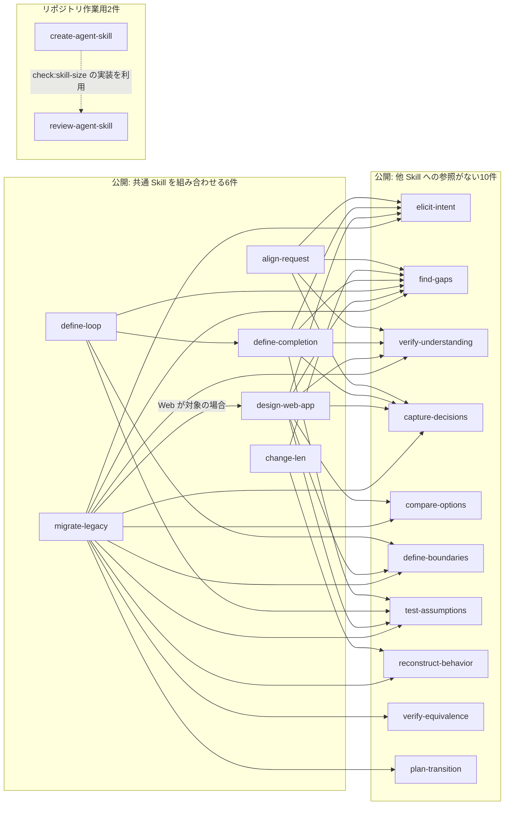

# Skill の依存関係

2026-10-12 時点の、このリポジトリで管理する現行18 Skill（公開16・作業用2）を対象にする。参照元は各 `SKILL.md` と `package.json`。調査したコミットは `b40988db69bbfbaf227b5a40b4bd882856ebb7c3`。

実線の `A → B` は、A が必要な場面で B の指示を読み、適用する関係を表す。常に全 Skill を実行する順序や、自動インストールされる依存定義ではない。点線は Skill の呼出しではなく、付属スクリプトの利用を表す。

Skill 間の直接参照は33本あり、循環はない。`archive/` 内の過去の `SKILL.md` の写し、参照資料、外部ツール・ライブラリは Skill のノードに含めない。

## 直接参照の一覧

推移的な参照は加えない。たとえば `define-loop → define-completion → elicit-intent` は図でたどれるが、`define-loop → elicit-intent` の矢印は追加しない。

| Skill                                                            | 直接参照する Skill                                                                                                                                                                                                     |
| ---------------------------------------------------------------- | ---------------------------------------------------------------------------------------------------------------------------------------------------------------------------------------------------------------------- |
| [align-request](skills/align-request/SKILL.md)                   | elicit-intent、find-gaps、verify-understanding、capture-decisions                                                                                                                                                      |
| [capture-decisions](skills/capture-decisions/SKILL.md)           | なし                                                                                                                                                                                                                   |
| [change-len](skills/change-len/SKILL.md)                         | reconstruct-behavior、find-gaps                                                                                                                                                                                        |
| [compare-options](skills/compare-options/SKILL.md)               | なし                                                                                                                                                                                                                   |
| [define-boundaries](skills/define-boundaries/SKILL.md)           | なし                                                                                                                                                                                                                   |
| [define-completion](skills/define-completion/SKILL.md)           | elicit-intent、find-gaps、verify-understanding、test-assumptions、capture-decisions                                                                                                                                    |
| [define-loop](skills/define-loop/SKILL.md)                       | define-completion、find-gaps、test-assumptions、define-boundaries                                                                                                                                                      |
| [design-web-app](skills/design-web-app/SKILL.md)                 | elicit-intent、find-gaps、verify-understanding、compare-options、define-boundaries、test-assumptions、capture-decisions                                                                                                |
| [elicit-intent](skills/elicit-intent/SKILL.md)                   | なし                                                                                                                                                                                                                   |
| [find-gaps](skills/find-gaps/SKILL.md)                           | なし                                                                                                                                                                                                                   |
| [migrate-legacy](skills/migrate-legacy/SKILL.md)                 | elicit-intent、reconstruct-behavior、find-gaps、verify-understanding、compare-options、define-boundaries、design-web-app（Web が対象の場合）、test-assumptions、verify-equivalence、plan-transition、capture-decisions |
| [plan-transition](skills/plan-transition/SKILL.md)               | なし                                                                                                                                                                                                                   |
| [reconstruct-behavior](skills/reconstruct-behavior/SKILL.md)     | なし                                                                                                                                                                                                                   |
| [test-assumptions](skills/test-assumptions/SKILL.md)             | なし                                                                                                                                                                                                                   |
| [verify-equivalence](skills/verify-equivalence/SKILL.md)         | なし                                                                                                                                                                                                                   |
| [verify-understanding](skills/verify-understanding/SKILL.md)     | なし                                                                                                                                                                                                                   |
| [create-agent-skill](.agents/skills/create-agent-skill/SKILL.md) | なし。`npm run check:skill-size` が review-agent-skill 配下のスクリプトを利用する                                                                                                                                      |
| [review-agent-skill](.agents/skills/review-agent-skill/SKILL.md) | なし                                                                                                                                                                                                                   |

個別にインストールする場合は、必要な参照先とその参照先も含める。[README のインストール手順](README.md#完了条件とループ指示書に必要なスキルだけ入れる)を参照する。
